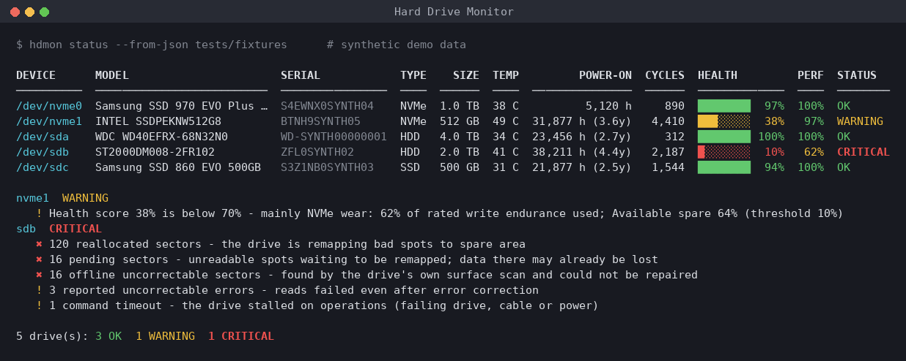
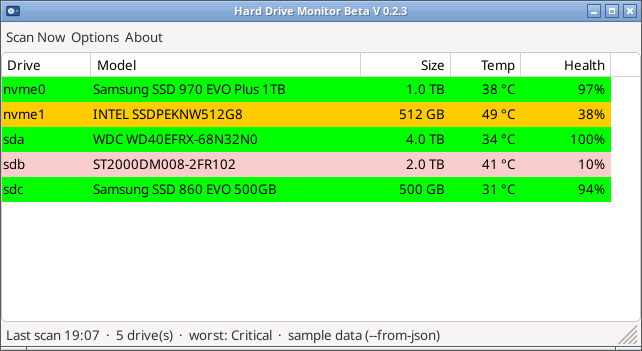
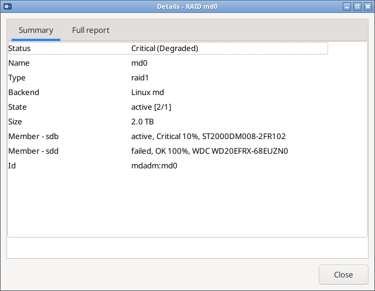
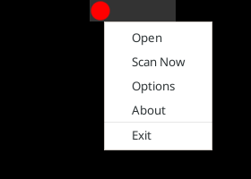
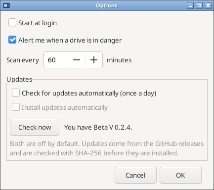
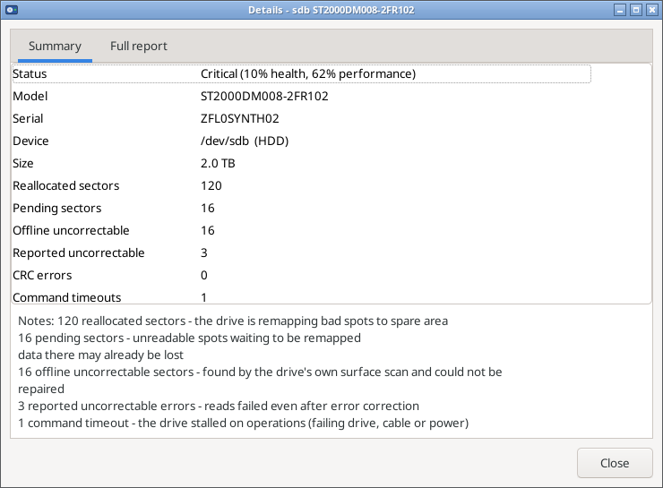
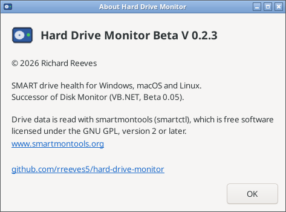
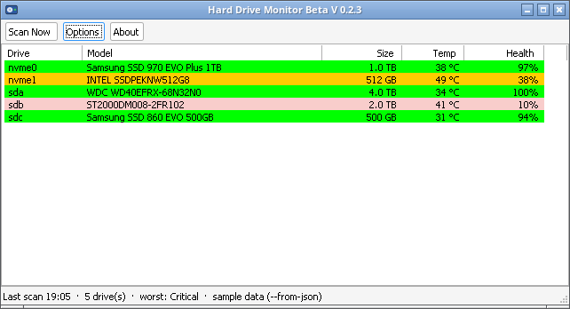

# Hard Drive Monitor

**Hard Drive Monitor** (`hdmon`) is a small command-line health monitor for hard drives, SATA SSDs and NVMe
drives on **Linux, macOS and Windows**, in the spirit of Hard Disk Sentinel. It reads SMART data
**natively through the operating system** (no smartmontools or other tools needed, see
[Native SMART](#native-smart-no-smartmontools-needed)), watches **RAID arrays** (see [RAID](#raid)), turns it into a
**Health %**, a **Performance %** and an **OK / WARNING / CRITICAL** status with plain-English reasons, keeps a
local history, and alerts you when something gets worse.

It is a **single native executable** per OS (C++17, no Python or other runtime needed): a fully static
`hdmon` on Linux, `hdmon.exe` (+ `hdmonw.exe`, the same program without a console window for the scheduled
task) on Windows, and a universal (arm64 + x86_64) `hdmon` on macOS.

## Download

Grab the ready-to-run executable for your system from the
[latest release](https://github.com/rreeves5/hard-drive-monitor/releases/latest):

| OS | File |
|---|---|
| Windows (64-bit) | [`hdmon-windows-x86_64.exe`](https://github.com/rreeves5/hard-drive-monitor/releases/latest/download/hdmon-windows-x86_64.exe) (plus [`hdmonw-windows-x86_64.exe`](https://github.com/rreeves5/hard-drive-monitor/releases/latest/download/hdmonw-windows-x86_64.exe), the no-window version for scheduled checks) |
| macOS (Apple Silicon + Intel) | [`hdmon-macos-universal`](https://github.com/rreeves5/hard-drive-monitor/releases/latest/download/hdmon-macos-universal) |
| Linux (x86_64, static) | [`hdmon-linux-x86_64`](https://github.com/rreeves5/hard-drive-monitor/releases/latest/download/hdmon-linux-x86_64) |

Desktop app (tray icon + window, see [Desktop app](#desktop-app-hdmon-gui)):

| OS | File |
|---|---|
| Windows (64-bit) | [`hdmon-gui-windows-x86_64.exe`](https://github.com/rreeves5/hard-drive-monitor/releases/latest/download/hdmon-gui-windows-x86_64.exe) |
| macOS (Apple Silicon + Intel) | [`Hard-Drive-Monitor-macos.zip`](https://github.com/rreeves5/hard-drive-monitor/releases/latest/download/Hard-Drive-Monitor-macos.zip) (contains `Hard Drive Monitor.app`) |
| Linux (x86_64, needs GTK 3) | [`hdmon-gui-linux-x86_64`](https://github.com/rreeves5/hard-drive-monitor/releases/latest/download/hdmon-gui-linux-x86_64) |

`SHA256SUMS.txt` in the release lists checksums. Nothing else is needed at run time (smartmontools is no longer
required). To put `hdmon` on your PATH and turn on the background check, use the installer below.

## Quick install

Run from a clone or the unzipped folder. Each installer copies the prebuilt `hdmon` binary from `dist/`
(or builds it with CMake if there is none for your machine) into a per-user bin folder, puts it on your PATH
(works in any new terminal) **and turns on the automatic background check** (hourly + at login/boot):

| OS | One line |
|---|---|
| Linux | `./install.sh` |
| macOS | `./install.sh` |
| Windows | `powershell -ExecutionPolicy Bypass -File .\install.ps1` (in an **elevated** PowerShell for full SMART access) |

Opt out of the background check with `./install.sh --no-service` or `install.ps1 -NoService`. Undo
everything with `./uninstall.sh` or `.\uninstall.ps1`. On Linux the installer offers to let `hdmon` read SMART
without sudo (`--setcap`, see [SMART access](#smart-access-root--admin)).



*The screenshot uses the synthetic test fixtures in `tests/fixtures/`, not real drives.*

> **Disclaimer.** Hard Drive Monitor is an **early-warning tool, not a guarantee**. Many drives die suddenly
> with perfect SMART data, and a WARNING drive can keep going for years. A good score does not mean
> your data is safe. **Keep backups.** The Health and Performance numbers are heuristics, not
> manufacturer figures or benchmarks.

## Features

- Drive discovery (native, no external programs)
  - Linux: `/sys/block` (whole disks; partitions, loop, zram and md devices skipped), mount points from `/proc/mounts`
  - macOS: IOKit (physical disks; APFS containers are mapped back to the disk they live on)
  - Windows: `\\.\PhysicalDriveN` + `IOCTL_STORAGE_GET_DEVICE_NUMBER` for drive letters, so you see e.g.
    `PhysicalDrive1 (D:)`. Without admin rights it uses the Windows Storage WMI classes (`MSFT_PhysicalDisk` +
    `MSFT_StorageReliabilityCounter`: wear, temperature, read/write errors, power-on hours).
- SATA/ATA HDDs and SSDs, and NVMe. Shows model, serial, capacity, type, temperature, power-on hours, power cycles and:
  - ATA: reallocated sectors (5), reported uncorrectable (187), command timeout (188), pending sectors (197),
    offline uncorrectable (198), UDMA CRC errors (199), SSD wear (device statistics or attributes 231/233/202/169/177)
  - NVMe: `percentage_used`, `media_errors`, `critical_warning`, `available_spare`, `unsafe_shutdowns`,
    error-log entries, time spent above warning temperature
- Commands (all accept `--json`):

| Command | What it does |
|---|---|
| `hdmon status` (or `hdmon list`) | Colored table of all drives and RAID arrays (members indented under their array), plus reasons for anything not OK. Records the run to history. |
| `hdmon raid` | RAID arrays only: type, backend, state, rebuild %, size and every member with its health. Exit code 0/1/2 by the worst array. |
| `hdmon detail <dev>` | Full attribute view: every ATA attribute, the NVMe health log, self-test log. `<dev>` can be `/dev/sda`, `sda`, `nvme0`, `disk0`, a serial number, or a Windows drive letter like `D:`. |
| `hdmon history` | Health/temperature sparklines from the SQLite log and every counter that got worse. |
| `hdmon check` | One scheduled-style run: record, alert on worsening, exit code 0/1/2 = OK/WARNING/CRITICAL (3 = error). |
| `hdmon watch --interval 1h` | Loop mode (`check` every interval; `--count N` to stop). |
| `hdmon selftest <dev> [short\|long]` | Starts a SMART self-test natively (ATA SMART EXECUTE OFF-LINE / NVMe Device Self-test; smartctl only as fallback) and prints the expected duration. `--results` shows the self-test log. |
| `hdmon install-service` / `uninstall-service` | Hourly schedule: systemd user timer / launchd agent / Task Scheduler. |
| `hdmon init-config` | Writes a commented sample config. |
| `hdmon alert-test` | Sends a test notification (and e-mail, if enabled). |
| `hdmon update [--check]` | Looks for a newer GitHub release; installs it (checksum-verified) only when you run it. See [Updates](#updates). |

- `--from-json FILE_OR_DIR` (status, detail, check, watch, raid, selftest --results): read saved
  `smartctl -x --json` output (and RAID sources such as a saved `/proc/mdstat`, see `tests/fixtures/raid/`)
  instead of live drives. Useful for demos, for checking a drive from another
  machine, or for bug reports. A `--from-json` run is **not** written to history unless you add `--record`.

## Native SMART (no smartmontools needed)

Since 0.2.4 `hdmon` and `hdmon-gui` read SMART data themselves, through the operating system:

| OS | ATA / SATA (incl. USB bridges that support SAT) | NVMe |
|---|---|---|
| Linux | `SG_IO` ATA PASS-THROUGH(16) (12-byte CDB as fallback): IDENTIFY, SMART READ DATA, READ THRESHOLDS, RETURN STATUS | `NVME_IOCTL_ADMIN_CMD`: Identify Controller + Get Log Page 02h |
| Windows | `IOCTL_ATA_PASS_THROUGH` (falls back to `SMART_RCV_DRIVE_DATA`) | `IOCTL_STORAGE_QUERY_PROPERTY` / `StorageDeviceProtocolSpecificProperty` (Identify + log page 02h) |
| macOS | IOKit `IOATASMARTInterface` | IOKit NVMe SMART interface (internal NVMe) |

The raw sectors are decoded into the same attribute model the smartctl path used, and scored by the same code,
so health scores and statuses are identical. This was checked byte for byte on a real Linux kernel with
emulated AHCI and NVMe drives (`tools/vm-verify/`, captures in `tests/fixtures/native/qemu/`): native and
`smartctl -x --json` gave the same attributes, raw values, health and status.

- **Which source was used** is always shown: the `Source:` line under `hdmon status`, `Source:` in
  `hdmon detail`, `"source"` per drive in `--json`, and the GUI status line. Values are `native (SG_IO ATA
  PASS-THROUGH(16))`, `native (NVMe admin ioctl)`, `native (DeviceIoControl ...)`, `smartctl (...)`, or
  `windows-storage` (WMI reliability counters).
- **smartmontools is optional.** With `[smart] source = "auto"` (default), smartctl is used only when it happens
  to be installed and the native read fails for a drive (SAS disks, unusual USB bridges), and for disks behind
  hardware RAID controllers. `source = "native"` never runs it; `source = "smartctl"` uses only smartctl.
  smartmontools is credited in the GUI's About box only when the fallback was actually used.
- `HDMON_NATIVE_DUMP=<dir> hdmon status` writes the raw sectors it read (`*-identify.bin`, `*-smart-data.bin`,
  `*-nvme-log02.bin`, ...) for bug reports.

## RAID

`hdmon status`, `hdmon check`, `hdmon raid` and the desktop app show RAID arrays as their own rows, with the
member disks indented underneath. A disk that belongs to an array is listed only under it, never twice.

| Backend | How it is read | Notes |
|---|---|---|
| Linux md (mdadm) | `/proc/mdstat` + `/sys/block/md*/md/` (level, array_state, degraded, sync_action, sync_completed, per-member state/slot) | `mdadm --detail` only as an optional extra |
| Windows Storage Spaces | WMI `root\Microsoft\Windows\Storage`: `MSFT_StoragePool`, `MSFT_VirtualDisk`, `MSFT_PhysicalDisk`, `MSFT_StorageJob` (repair %) | PowerShell `Get-StoragePool`/`Get-VirtualDisk`/... only if WMI fails |
| Intel RST / VMD | RAID volumes show up as virtual disks; member state from `rstcli`/`IntelVROCCli` when installed | members behind RST are not visible to SMART without the vendor driver |
| macOS AppleRAID | IOKit `AppleRAIDSet` / `AppleRAIDMember` registry properties | mirror/stripe/concat, rebuild %; `diskutil appleRAID list` only if IOKit fails |
| Hardware RAID cards | `smartctl --scan-open` members (`-d megaraid,N`, `aacraid`, `areca`, `3ware`, `cciss`, `hpt`, `sssraid`, `jmb39x`) grouped per controller | needs smartmontools; logical-drive state needs the vendor tool, so the array shows the worst member |

- **Array model:** name, type/level, backend, state (OK / DEGRADED / REBUILDING / FAILED), rebuild %, size and
  members (role: active, spare, failed, rebuilding, missing).
- **Health rollup:** an array's status is the worst of its own state and its members' SMART status.
  DEGRADED and REBUILDING are WARNING, FAILED is CRITICAL, and a degraded mirror with a critical member is
  CRITICAL. The tray colour counts arrays too.
- **Alerts** (`hdmon check`, the background check and the desktop app): an array becoming degraded or failed,
  a rebuild starting, and a rebuild completing. Array state is recorded in the same history database
  (`array_readings` table).
- **JSON:** `hdmon status --json` has an `arrays` list (state, rebuild_percent, status, members with their
  drive keys).
- **Config:** `[raid] enabled = false` hides arrays. `[raid] smartctl_devices = ["/dev/sg0 -d cciss,0"]` adds
  controller members that `--scan-open` does not find.
- Sample data: `hdmon status --from-json tests/fixtures/raid/sample` (a degraded md mirror with one critical
  member, plus a MegaRAID controller). Parser fixtures for every backend are in `tests/fixtures/raid/`.

| Main window with RAID | RAID details |
|---|---|
|  |  |

## Desktop app (hdmon-gui)

`hdmon-gui` is the desktop version of Hard Drive Monitor. It replaces the Windows-only VB.NET **Disk Monitor**
tray app (Beta 0.05), rewritten in C++ on top of the same core as the `hdmon` command. It uses the same
scanner, health scores, history database, config file, alerts and updater, and has the same look and
behaviour on Windows, macOS and Linux. The `hdmon` command is unchanged; the app is a separate program.

| Main window | Tray menu |
|---|---|
|  |  |
| **Options** (updates are off by default) | **Details** |
|  |  |
| **About** | **Windows build (running under Wine)** |
|  |  |

*Screenshots use the synthetic test drives (`hdmon-gui --from-json tests/fixtures`; the main window and RAID
details use `tests/fixtures/raid/sample`) on Linux/GTK under Xvfb, regenerated with `tools/gui_screenshots.sh`. The Windows one is the cross-compiled exe running under Wine.*

- **Tray icon:** a plain circle in the colour of the **worst** drive. Green = OK, yellow = WARNING, red =
  CRITICAL, gray = no data/no SMART. Statuses come from the same scoring as `hdmon status`. Hover to see each
  drive (letter, mount point or device) with its health %. Right-click (on macOS, click) for **Open, Scan Now,
  Options, About, Exit**. Double-click opens the window.
- **Window:** one row per drive (Drive, Model, Size, Temp, Health), each tinted with its own status colour.
  RAID arrays get a **bold** row in the array's status colour with a ▼/▶ arrow (click it, double-click the row, or
  right-click > Collapse/Expand) and the state in the Health column ("Degraded", "Rebuilding 45.0%"); their
  member disks are indented underneath. Right-click > Details on an array shows its members and state.
  Double-click a row (or right-click > Details) for the details: the counters the drive reports plus the full
  `hdmon detail` report. The title bar and status line show when a scan is running.
- **Scans** every 60 minutes by default (Options > Scan every N minutes) and on **Scan Now**. Every scan goes into
  the **same history database as the CLI**, so `hdmon history` shows both. When something gets worse (the same
  rules as `hdmon check` alerts), you get a notification plus a red "Drive in danger" window, and an e-mail if
  `[email]` is enabled. Turn this off with "Alert me when a drive is in danger".
- **Options:** Start at login (off by default, like the VB app), danger alerts, scan interval, and **Updates**:
  "Check for updates automatically" is **off by default** and only notifies (the same `[update] auto_check`
  setting the CLI uses). Updates are never downloaded or installed on their own: **Check now** asks GitHub, and installs
  only after you confirm, with a SHA-256 check. On macOS it opens the download page instead.
  Settings are stored in `config.toml` (`[gui] alert_on_danger`, `scan_interval_minutes`).
- **Start at login** works differently per system:
  - Windows: a Task Scheduler logon task with highest privileges (an app that requires admin is skipped when
    started from the Run key). If the app isn't elevated, it uses the `HKCU\...\Run` key.
  - macOS: `~/Library/LaunchAgents/com.rreeves5.hard-drive-monitor.gui.plist`.
  - Linux: `~/.config/autostart/hard-drive-monitor.desktop`.
- **Admin rights:**
  - Windows: `hdmon-gui.exe` asks for elevation on start, like Disk Monitor did (embedded manifest with
    `requireAdministrator`). Without admin it falls back to the Windows Storage counters.
  - Linux/macOS: the same rules as the CLI apply (see [SMART access](#smart-access-root--admin)).
    Drives it can't read show up gray, and the status line explains why.
- **Command line:** `hdmon-gui [--show] [--from-json DIR] [--config FILE] [--db FILE] [--version]`. `--show` opens
  the window at start; otherwise the app starts in the tray, like Disk Monitor. If the desktop has no tray
  (e.g. GNOME without an AppIndicator extension), the window opens and closing it quits.
- **Installers:** `install.sh` / `install.ps1` also install the app when a build is present (`dist/` or next to the
  script). On Windows that adds a Start Menu shortcut, on Linux a menu entry, and on macOS it copies the app
  to `~/Applications`. Skip it with `--no-gui` / `-NoGui`.
- **Building it:** it uses [wxWidgets](https://www.wxwidgets.org) 3.2 (native widgets on every OS, wxWindows
  licence):

  ```sh
  sudo apt install libwxgtk3.2-dev          # Linux, system wxWidgets
  cmake -S . -B build-gui -DHDMON_BUILD_GUI=ON && cmake --build build-gui --target hdmon-gui
  # Windows/macOS (or a self-contained Linux build): download wxWidgets and link it statically
  cmake -S . -B build-gui -DHDMON_BUILD_GUI=ON -DHDMON_WX_FETCH=ON && cmake --build build-gui --config Release --target hdmon-gui
  ```

## Install

Nothing is needed at run time: SMART is read natively. smartmontools is optional (fallback only).

Prebuilt binaries (also attached to GitHub releases by CI for `v*` tags):

| File | OS |
|---|---|
| `dist/hdmon-linux-x86_64` | Linux x86_64, fully static (any distro) |
| `dist/hdmon-windows-x86_64.exe` + `dist/hdmonw-windows-x86_64.exe` | Windows 10/11 x64 (no DLLs beyond Windows itself) |
| `hdmon-macos-universal` | macOS 10.15+, Apple Silicon + Intel (built by CI only) |

### What the installers do

`install.sh` (Linux, macOS):

1. Picks a binary that runs on this machine: `--binary FILE`, then `./hdmon` next to the script, then
   `dist/hdmon-<os>-<arch>` / `dist/hdmon-macos-universal`, then `build/hdmon`. If none runs, it **builds from
   source with CMake** (needs `cmake` 3.16+ and a C++17 compiler; `--build` forces this).
2. Copies it to `~/.local/bin/hdmon` (atomic replace, so it is safe while the background check runs).
3. Puts `~/.local/bin` on PATH with a marked block in `~/.profile`, `~/.bashrc`, `~/.bash_profile` (if it
   exists) and `~/.zshrc` (if it exists, always on macOS). Running it again does not add duplicates.
4. Linux: offers to grant `hdmon` (and `hdmon-gui`) the capabilities for raw disk commands with `setcap`, so the
   background check can read SMART without sudo (asks interactively; `--setcap` / `--no-setcap` to decide up
   front). macOS needs nothing for internal drives.
5. Runs `hdmon install-service` to schedule the background check (skip with `--no-service`).
6. `--system` also symlinks `hdmon` into `/usr/local/bin` (uses sudo).
7. Leaves automatic update checks **off** (turn on the daily notify-only check later with `hdmon update --enable-auto-check`).

`install.ps1` (Windows):

1. Picks `-Binary FILE`, then `hdmon.exe` next to the script, then `dist\hdmon-windows-x86_64.exe`, then
   `build\Release\hdmon.exe`; otherwise builds with CMake (needs CMake + Visual Studio Build Tools or MinGW-w64).
2. Copies `hdmon.exe` and `hdmonw.exe` to `%LOCALAPPDATA%\hard-drive-monitor\bin` (`-System`:
   `%ProgramFiles%\hard-drive-monitor\bin`, needs admin).
3. Adds that folder to the **User** `Path` with `[Environment]::SetEnvironmentVariable('Path', ..., 'User')`;
   `-System` uses the **Machine** `Path`. Idempotent, and it broadcasts the change (`WM_SETTINGCHANGE`) so new
   windows see it. `hdmon` then works in cmd.exe and PowerShell alike (no shim needed any more).
4. Runs `hdmon install-service`: a Task Scheduler task at logon + hourly. When the script runs **elevated**
   the task gets **highest privileges**, so it can open the drives for full SMART data (skip with `-NoService`).
5. Leaves automatic update checks **off** (turn on the daily notify-only check later with `hdmon update --enable-auto-check`).

After installing, **open a new terminal / Command Prompt / PowerShell** and run `hdmon status`.

`uninstall.sh` / `uninstall.ps1` remove the scheduled check, the binary, the PATH entries the installer added
and the sudoers rule older versions created (if any). History and config are kept unless you pass
`--purge` / `-Purge`.

### Manual install (alternative)

It is one file, so you can also just copy it somewhere on your PATH:

```bash
# Linux
install -m 755 dist/hdmon-linux-x86_64 ~/.local/bin/hdmon
sudo ~/.local/bin/hdmon status --no-record   # quick look (raw disk access needs root, see below)

# macOS
install -m 755 hdmon-macos-universal ~/.local/bin/hdmon
hdmon status                                 # internal Apple SSDs often work without sudo
```

```powershell
# Windows
# copy hdmon.exe and hdmonw.exe to a folder on your Path, then in an elevated terminal:
hdmon status
```

If you install smartmontools anyway (optional fallback), Hard Drive Monitor finds `smartctl` in `/usr/sbin`,
Homebrew, `Program Files\smartmontools\bin` and Chocolatey locations.

External USB drives on macOS often do not pass SMART data through at all (that is the USB bridge, not this
tool); they show up as `UNKNOWN`.

**Administrator rights are needed** to open physical drives on Windows. Without admin, Hard Drive Monitor falls
back to the Windows Storage counters (WMI `MSFT_StorageReliabilityCounter`), which give fewer attributes and
sometimes none at all for USB drives.

### Build from source

```bash
cmake -S . -B build -DCMAKE_BUILD_TYPE=Release     # Windows/MSVC: add -A x64, build with --config Release
cmake --build build --parallel
ctest --test-dir build -C Release --output-on-failure
```

Requirements: CMake 3.16+, a C++17 compiler (GCC 9+, Clang 10+, AppleClang, MSVC 2019+ or MinGW-w64). All
dependencies are vendored single files in `third_party/`: [nlohmann/json](https://github.com/nlohmann/json)
3.11.3, the [SQLite](https://sqlite.org) 3.46.1 amalgamation and [doctest](https://github.com/doctest/doctest)
2.4.11 (tests only). No Boost. Options: `-DHDMON_STATIC=OFF` (dynamic linking), `-DHDMON_BUILD_TESTS=OFF`.

Cross-compile the Windows binaries from Linux with mingw-w64:

```bash
sudo apt install mingw-w64
cmake -S . -B build-win -DCMAKE_TOOLCHAIN_FILE=cmake/mingw-w64-x86_64.cmake -DCMAKE_BUILD_TYPE=Release
cmake --build build-win --parallel                 # -> build-win/hdmon.exe, hdmonw.exe, hdmon_tests.exe
```

## SMART access (root / admin)

Reading SMART data needs raw device access.

**Linux:** the ATA and NVMe pass-through commands need root, or these three capabilities on the binary:
`CAP_SYS_RAWIO` (ATA pass-through), `CAP_SYS_ADMIN` (NVMe admin commands) and `CAP_DAC_READ_SEARCH` (to open
`/dev/sdX` and `/dev/nvmeN`, which are root/disk-only). You have three options:

1. **Run it with sudo** for one-off checks: `sudo ~/.local/bin/hdmon status --no-record`. (Under sudo the history
   would go to root's home directory, hence `--no-record`.)
2. **Recommended for the background check: grant the capabilities once** (`./install.sh` offers it;
   `./install.sh --setcap` does it without asking):

   ```bash
   sudo setcap cap_sys_rawio,cap_sys_admin,cap_dac_read_search+ep ~/.local/bin/hdmon
   sudo setcap cap_sys_rawio,cap_sys_admin,cap_dac_read_search+ep ~/.local/bin/hdmon-gui   # desktop app
   ```

   hdmon then runs as you and can read the drives. This was tested as an unprivileged user (uid 1000) in the
   QEMU harness: no capabilities → every drive `UNKNOWN` with a hint; with them → full SMART. The capabilities
   belong to the file, so replacing the binary drops them. Since 0.2.5 `hdmon update` copies them onto the new
   file (works when it runs as root; otherwise it prints the exact `setcap` command), and `install.sh`
   re-applies them when the old binary had them. `setcap` is in `libcap2-bin` (Debian/Ubuntu) or `libcap` (Fedora, Arch). It does not work
   on filesystems mounted `nosuid`.
3. **Run the service as root** (`hdmon install-service --system` prints a root systemd unit / LaunchDaemon and
   the exact commands to install it; it never installs root services by itself). A root service keeps its
   history under root's home and cannot show desktop notifications in your session, so use e-mail alerts.

Older versions added a sudoers rule for smartctl. That is no longer needed; `uninstall.sh` still removes one
it created.

**macOS:** IOKit reads internal SATA and NVMe drives as a normal user. External USB drives often do not pass
SMART data through at all (that is the USB bridge); they show up as `UNKNOWN`.

**Windows:** run `install.ps1` (or `hdmon install-service`) from an **elevated** PowerShell so the scheduled task
gets highest privileges. From a normal window the task runs without admin and falls back to the Windows Storage
counters (WMI).

## Automatic background check (on by default)

The installers schedule `hdmon check --quiet` to run **every hour and shortly after login/boot**. Each run
records to the history database and alerts you only when something got worse.

| OS | What gets scheduled | Check it | Turn it off |
|---|---|---|---|
| Linux (systemd) | User timer `~/.config/systemd/user/hard-drive-monitor.{service,timer}`: 2 min after your session starts, then hourly (`Persistent=true` catches up after sleep). | `systemctl --user list-timers hard-drive-monitor.timer` | `hdmon uninstall-service` |
| Linux (no systemd user session, e.g. WSL/containers) | Two lines in your **crontab** marked `# hard-drive-monitor`: `@reboot` (+2 min) and hourly. | `crontab -l` | `hdmon uninstall-service` |
| macOS | launchd agent `~/Library/LaunchAgents/com.hard-drive-monitor.check.plist`: `RunAtLoad` (at login) + `StartInterval` 3600. Log: `~/Library/Logs/hard-drive-monitor.log`. | `launchctl print gui/$UID/com.hard-drive-monitor.check` | `hdmon uninstall-service` |
| Windows | Task Scheduler task `hard-drive-monitor` (registered through the Task Scheduler COM API; `schtasks` only as fallback): at logon (+2 min) and every hour, `hdmonw.exe check --quiet` (`hdmonw.exe` is the GUI-subsystem build, so no console window flashes). Highest privileges when installed from an elevated window. | `schtasks /Query /TN hard-drive-monitor` | `hdmon uninstall-service` |

Since 0.2.5 these are set up through native APIs: systemd's D-Bus `org.freedesktop.systemd1.Manager`
(`systemctl --user` only as fallback), Task Scheduler COM on Windows, and `SMJobSubmit` on macOS (`launchctl` as fallback).

`hdmon install-service` prints everything it writes. Options: `--interval 30m`, `--dry-run` (print only),
`--no-enable` (write files, don't enable), `--highest` (Windows: force highest privileges), `--system`
(print a root systemd unit / root LaunchDaemon and the commands to install it; root services are never
installed silently).

Notes:

- Linux user timers only run while you are logged in. To keep them running without a login:
  `sudo loginctl enable-linger $USER`.
- The background check runs **as you**. On Linux it can only read SMART data if `hdmon` has the capabilities from
  [SMART access](#smart-access-root--admin); without them drives show as `UNKNOWN`. macOS internal drives work anyway.

## Alerts

Alerts fire **only when something gets worse** compared with the previous recorded run: the status worsens
(OK to WARNING, WARNING to CRITICAL), or one of these counters increases: reallocated, pending, offline
uncorrectable, reported uncorrectable, command timeouts, UDMA CRC errors, NVMe media errors, Windows
uncorrected errors. A drive that has had 12 reallocated sectors for a year does not alert you every hour; it
alerts again the moment it becomes 13. Wear and unsafe-shutdown counts rise normally, so they are shown as
trends in `hdmon history` but do not alert on their own.

- Desktop (native since 0.2.5): Linux sends `org.freedesktop.Notifications.Notify` over the D-Bus session bus
  directly; Windows shows a `Shell_NotifyIcon` balloon; macOS uses `UNUserNotificationCenter` inside the app
  bundle. `notify-send`, `osascript` and PowerShell are only fallbacks. If nothing works, it says so and skips.
- E-mail: SMTP settings in the config file. The native build has no SMTP library; it sends mail by running the
  **`curl` command-line tool** (`smtp://` + STARTTLS via `--ssl-reqd`, or `smtps://` when `ssl = true`). curl
  ships with Windows 10 1803+ and macOS, and is one package away on Linux (`sudo apt install curl`). The
  password is passed to curl on stdin (`curl -K -`), never on the command line. If curl is missing,
  `hdmon alert-test` says so and desktop notifications still work.

## Configuration

`hdmon init-config` writes a commented sample (file mode 600):

- Linux/macOS: `~/.config/hard-drive-monitor/config.toml`
- Windows: `%APPDATA%\hard-drive-monitor\config.toml`

```toml
[smart]
source = "auto"          # "auto" (native, smartctl fallback if installed) | "native" | "smartctl"

[raid]
enabled = true
smartctl_devices = []    # extra hardware RAID members, e.g. ["/dev/sg0 -d cciss,0"]

[smartctl]               # optional fallback only
sudo = "auto"            # "auto" | true | false
# path = "/usr/sbin/smartctl"

[alerts]
desktop = true

[email]
enabled = true
host = "smtp.gmail.com"
port = 587
starttls = true
username = "you@example.com"
password_env = "HDMON_SMTP_PASSWORD"   # read the password from this environment variable
from = "you@example.com"
to = ["you@example.com"]

[thresholds]             # temperatures in C
hdd_temp_warn = 50
hdd_temp_crit = 55

[ignore]
devices = ["/dev/sdz"]

[update]                 # OFF by default - see "Updates"
auto_check = false
```

The file is read by a small built-in parser that handles the simple TOML subset above (`[sections]`,
`key = value` with strings, integers, floats, booleans, arrays and `#` comments).

History database (SQLite):

- Linux: `~/.local/share/hard-drive-monitor/history.db`
- macOS: `~/Library/Application Support/hard-drive-monitor/history.db`
- Windows: `%LOCALAPPDATA%\hard-drive-monitor\history.db`

## Updates

Updating is **opt-in**. Nothing checks for or installs updates unless you ask.

```sh
hdmon update --check          # "Up to date: ..." or "Update available: Beta V x.y.z" + release link
hdmon update --check --json   # {"current", "latest", "latest_tag", "update_available", "url", ...}
hdmon update                  # download, verify, then ask "[y/N]" before installing
hdmon update --yes            # same, without the question (-y)
```

- It asks GitHub for the latest release of
  [rreeves5/hard-drive-monitor](https://github.com/rreeves5/hard-drive-monitor/releases/latest)
  (`https://api.github.com/repos/rreeves5/hard-drive-monitor/releases/latest`) with the **`curl`
  command-line tool**, the same one used for e-mail. It ships with Windows 10+ and macOS; on Linux, `sudo apt install curl`.
- Versions are compared by number (`v0.2.10` is newer than `v0.2.9`). `--check` exits 0 when you're up to date,
  1 when an update is available and 3 on error.
- `hdmon update` downloads the file for your system (`hdmon-linux-x86_64`, `hdmon-macos-universal`, or
  `hdmon-windows-x86_64.exe` + `hdmonw-windows-x86_64.exe`) plus `SHA256SUMS.txt`. Each file's SHA-256 is
  checked with a built-in implementation before anything is replaced. If a checksum is wrong or missing, the
  installed binary stays as it was.
- How the binary gets replaced:
  - **Linux/macOS:** the new file goes into a temp file in the same folder, gets `chmod 755`, and is
    atomically `rename`d over the old one, so a check that is running at that moment is unaffected. If the folder
    isn't writable (e.g. a root-owned install), run `sudo hdmon update`.
  - **Windows:** a running `.exe` can't be overwritten, but it can be renamed. `hdmon.exe` becomes
    `hdmon.old.exe` and the new file is moved in. The same happens for `hdmonw.exe` next to it. The `.old.exe`
    files are deleted the next time hdmon runs.
- Linux on ARM has no prebuilt binary, so build from source there.

### Automatic update checks (off by default)

```toml
[update]
auto_check = false     # default
```

- `auto_check = true`: the scheduled `hdmon check` (and `watch`) checks GitHub **at most once every 24 hours**
  (the time is kept in `update-state.json` next to the history database). When a new release appears, you get
  **one desktop notification per new version** (not with `--no-alert`) and a line in the output. **Nothing is
  installed.**
- Updates are **never downloaded or installed automatically** (the old `auto_install` key was removed in 0.2.5
  and is ignored if still present). Install with `hdmon update` or the GUI's **Check now**.
- With `auto_check = false` (the default), `check` never touches the network.
- Toggle it with `hdmon update --enable-auto-check` / `hdmon update --disable-auto-check`, or edit `config.toml`.
  The installers never turn it on.

## How the scores work

### Health %

Health starts at **100**. Each defect removes a **percentage of what is left** (so the score drops quickly for
the first few bad sectors and then flattens out, like Hard Disk Sentinel). This is the same model as the author's
Windows DiskMonitor tool, so the numbers line up.

| Defect | Each one keeps | i.e. roughly |
|---|---|---|
| Reallocated sector (ATA 5) | 99.0% | -1% each |
| Pending sector (197) | 97.0% | -3% each |
| Offline uncorrectable (198) | 97.0% | -3% each |
| Reported uncorrectable (187) | 98.0% | -2% each |
| Command timeout (188) | 99.5% | -0.5% each |
| NVMe media error | 97.0% | -3% each |
| Windows uncorrected read/write error (fallback mode) | 98.0% | -2% each |
| SSD/NVMe wear | multiply by (100 - % used) / 100 | 62% used leaves 38% |

Then hard caps apply: drive's own SMART verdict FAILED (or Windows "Unhealthy"): at most **5%**; an attribute
below its failure threshold right now: at most **10%**; NVMe spare below its threshold: at most **10%**; NVMe
critical warning (spare, reliability, read-only, backup failure): at most **20%**.

Example: 12 reallocated sectors give 100 x 0.99^12 = **88%**. The synthetic failing drive (120 reallocated,
16 pending, 16 offline uncorrectable, 3 reported uncorrectable, 1 timeout) scores **10%**.

UDMA CRC errors (199) are **not** counted against Health: they mean data got garbled on the cable or port,
not that the disk surface is bad. They still make the status WARNING ("reseat or replace the SATA cable") and
lower Performance. Temperature never changes Health either; it affects status and Performance.

### Status

- **CRITICAL**: Health below 30%, SMART FAILED, an attribute failing now, NVMe critical warning / spare below
  threshold, wear at 100% or more, temperature at the critical limit, or a large count of one bad-sector
  type (10+ pending/offline/reported/media errors, 100+ reallocated).
- **WARNING**: Health at or below `100 - warn_drop_percent` (`[alerts] warn_drop_percent`, default 10, so 90%; GUI Options "Warn when health drops by"), or any of the counters above is non-zero, an attribute failed in the past,
  CRC errors, NVMe spare close to its threshold, or temperature at the warning limit.
- **OK**: none of the above. **UNKNOWN**: no SMART data (virtual disk, USB bridge, permissions).

Default temperature limits (warning / critical): HDD 50 / 55 C, SATA SSD 60 / 70 C, NVMe 70 / 80 C, or the
drive's own limits if it reports them. Change them under `[thresholds]`.

### Performance %

An estimate of how much the drive's condition is likely slowing it down. It is **not a benchmark**. Starts at
100 and subtracts:

| Cause | Points | Max |
|---|---|---|
| UDMA CRC errors (retransmits) | 1 each | 30 |
| Command timeouts (stalls) | 2 each | 30 |
| Pending sectors (repeated re-reads) | 1 each | 20 |
| Reallocated sectors (extra seeks to the spare area) | 0.1 each | 20 |
| Offline uncorrectable | 0.5 each | 10 |
| NVMe media errors | 1 each | 10 |
| Currently at warning / critical temperature | 10 / 25 | |
| NVMe time above warning/critical temperature (throttling) | 1 + hours | 15 |

All constants live at the top of `src/health.cpp`.

## Examples

```bash
hdmon status
hdmon status --json | jq '.drives[] | {dev: .drive.device, health: .assessment.health, status: .assessment.status}'
hdmon detail /dev/sdb
hdmon detail D:                       # Windows drive letter
hdmon history --limit 48
hdmon selftest /dev/sda short         # prints expected duration
hdmon selftest /dev/sda --results
hdmon watch --interval 30m

# Demo without real drives (synthetic fixtures):
hdmon status --from-json tests/fixtures
hdmon detail nvme1 --from-json tests/fixtures
hdmon status --from-json tests/fixtures/windows/windows_inventory.json
```

Save a drive's data for later or for a bug report: `sudo smartctl -x --json /dev/sda > sda.json`, then
`hdmon detail sda --from-json sda.json`.

## Development

```bash
cmake -S . -B build && cmake --build build -j && ./build/hdmon_tests   # or: ctest --test-dir build
python3 tests/fixtures/make_fixtures.py    # regenerate the synthetic fixtures (dev tool)
python3 tools/render_demo.py               # regenerate demo-status.png from build/hdmon (needs Pillow)
```

Layout: `src/` (one module per concern: `native_smart` (decoders) + `native_linux` / `native_windows` /
`native_macos` (OS access), `smart` smartctl parsing and the optional smartctl fallback, `raid` / `raid_live` arrays,
`wmi` Windows Storage WMI, `health` scoring,
`history` SQLite, `alerts`, `service` scheduling, `update` opt-in self-update, `render`, `cli`, plus `gui_model` /
`autostart` for the desktop app), `gui/` (the wxWidgets app), `cmake/gui.cmake`, `tests/` (doctest), `third_party/`.
Platform-specific code is behind `#ifdef _WIN32` / `__APPLE__` / `__linux__`. SMART, drive discovery, md RAID
and Storage Spaces use OS APIs directly. The programs still run as child processes are listed with the
reason for each in `docs/shell-outs.md`.

The fixtures in `tests/fixtures/` are **synthetic**: hand-written to match the shape of `smartctl -x --json`
(smartmontools 7.4), the Windows inventory query, `/proc/mdstat`, `mdadm --detail`, Storage Spaces,
`diskutil appleRAID list` and `rstcli`. They were not captured from real drives, and their serial numbers
are fake. JSON files carry a `_synthetic` marker. `tests/fixtures/native/*.bin` are raw ATA and NVMe sectors
encoded from those JSON files by `make_native_fixtures.py`. The one exception is `tests/fixtures/native/qemu/`:
real kernel captures from emulated QEMU drives, with smartctl's output for the same devices
(regenerate with `tools/vm-verify/verify.sh`).

`tests/expected/` holds the output of the original Python implementation (0.1.0) on those fixtures. The
C++ test suite checks the native build against it: identical Health/Performance/status and reasons for every
fixture and scenario, identical alert text, and byte-identical `status` / `detail` / `selftest` output.
(0.2.4 changed one line in those files: the Windows fallback note no longer tells you to install smartmontools.)

CI (GitHub Actions) builds and tests on Ubuntu, macOS and Windows, smoke-tests the installers, and on a
`v*` tag attaches the Linux, macOS and Windows binaries, the desktop app builds (`hdmon-gui-*`, `Hard-Drive-Monitor-macos.zip`) and `SHA256SUMS.txt` to a GitHub release.

### Changes from the Python version (0.1.x)

- `hdmon serve` (the local web dashboard) was **dropped**; use `hdmon status`, or `--json` for your own tooling.
- E-mail goes through the `curl` command-line tool instead of Python's smtplib (see Alerts).
- The config file is read by the built-in TOML-subset parser only (no `tomllib`).
- Everything else (commands, options, exit codes, scores, reasons, history database format, file locations)
  is unchanged; an existing `history.db` keeps working.

## License

MIT. See [LICENSE](LICENSE).
